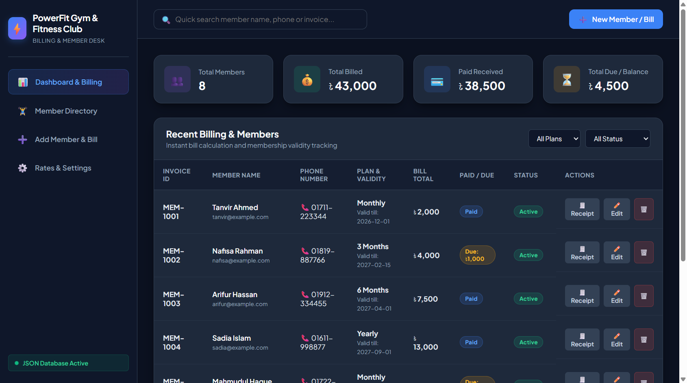
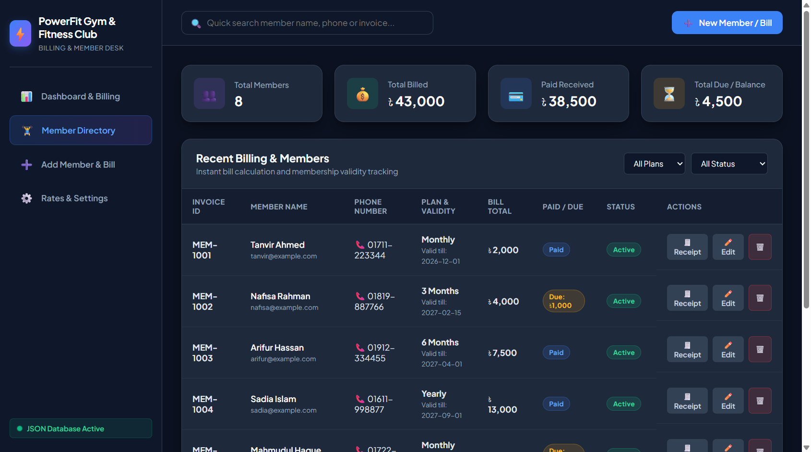
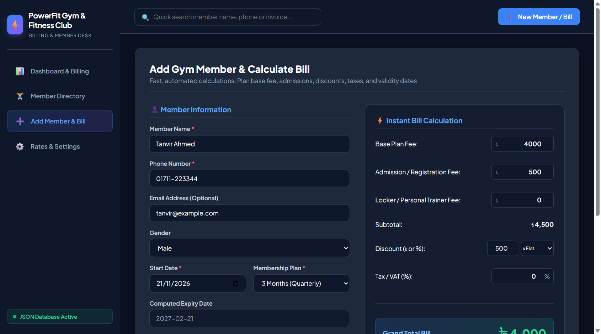
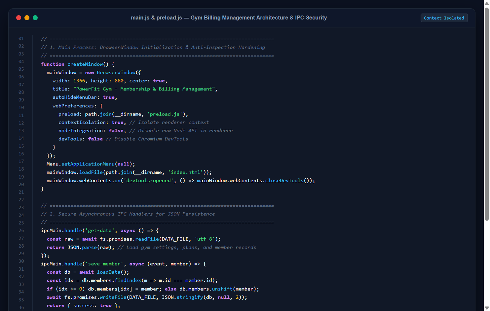

# 🏋️ PowerFit Gym — Membership & Billing Management Desktop Application

[](https://www.electronjs.org/)
[](https://www.electronjs.org/)
[](data.json)
[](#-anti-inspect--tamper-protections)
[](package.json)

> **বাংলা সারসংক্ষেপ (Project Summary in Bengali):**  
> **পাওয়ারফিট জিম ম্যানেজমেন্ট (PowerFit Gym Management)** হলো জিমনেসিয়াম ও ফিটনেস সেন্টারের সদস্য তথ্য এবং দ্রুত মেম্বারশিপ বিলিং পরিচালনার জন্য একটি স্বয়ংসম্পূর্ণ অফলাইন ডেস্কটপ অ্যাপ্লিকেশন, যা **ইলেকট্রন (Electron.js), নোডজেএস (Node.js), এইচটিএমএল, সিএসএস এবং জাভাস্ক্রিপ্ট** দিয়ে তৈরি। এটি বিভিন্ন মেম্বারশিপ প্ল্যান (মাসিক, ৩ মাস, ৬ মাস, বাৎসরিক) অনুযায়ী বেস ফি, ভর্তি ফি, লকার/ট্রেইনার অ্যাড-অন এবং ছাড় হিসাব করে স্বয়ংক্রিয়ভাবে সদস্যের মেয়াদোত্তীর্ণের তারিখ ও প্রিন্টযোগ্য ক্যাশ মানি রিসিট তৈরি করে। সম্পূর্ণ ডেটাবেজ লোকাল JSON ফাইলে সংরক্ষিত থাকে এবং এটি বিভিন্ন অপারেটিং সিস্টেমের জন্য বান্ডল করা হয়েছে: উইন্ডোজ (`.exe`), লিনাক্স (`.deb` / AppImage), এবং ম্যাক (`.dmg`)।

---

## 📑 সূচিপত্র / Table of Contents

- [প্রজেক্ট রিপোর্ট সারাংশ / Project Report Summary](#-প্রজেক্ট-রিপোর্ট-সারাংশ--project-report-summary)
- [সকল স্ক্রিনের প্রিভিউ / All Application Screens Preview](#-সকল-স্ক্রিনের-প্রিভিউ--all-application-screens-preview)
- [বিলিং হিসাবের সূত্র / Billing Formulas](#-বিলিং-হিসাবের-সূত্র--billing-formulas)
- [মাল্টি-অপারেটিং সিস্টেম বান্ডল / Multi-OS Bundling (.exe, .deb, .dmg)](#-মাল্টি-অপারেটিং-সিস্টেম-বান্ডল--multi-os-bundling-exe-deb-dmg)
- [অ্যাপ্লিকেশন চালানোর নিয়ম / How to Launch the Application](#-অ্যাপ্লিকেশন-চালানোর-নিয়ম--how-to-launch-the-application)
- [প্রজেক্ট ফাইল ডিরেক্টরি / Project Architecture](#-প্রজেক্ট-ফাইল-ডিরেক্টরি--project-architecture)

---

## 📋 প্রজেক্ট রিপোর্ট সারাংশ / Project Report Summary

### ১. সমস্যা বিবৃতি (Problem Statement)
জিম ও ফিটনেস ক্লাবগুলোতে মেম্বারদের সাবস্ক্রিপশন প্ল্যান, মেয়াদোত্তীর্ণের তারিখ, অ্যাডমিশন ফি, লকার বা পার্সোনাল ট্রেইনারের অ্যাড-অন ফি এবং বকেয়া টাকার হিসাব ম্যানুয়ালি খাতা বা সাধারণ ফাইলে রাখা অত্যন্ত জটিল ও সময়সাপেক্ষ। এতে মেয়াদোত্তীর্ণ সদস্যদের শনাক্ত করতে দেরি হয় এবং আর্থিক হিসাবে ভুল হওয়ার আশঙ্কা থাকে। এছাড়া সাধারণ ওয়েব অ্যাপে ক্লায়েন্ট-সাইড ইন্সপেক্ট এলিমেন্টের মাধ্যমে মেম্বারশিপ ফি ও স্ট্যাটাস টেম্পার করা সম্ভব। তাই একটি স্বয়ংসম্পূর্ণ, অফলাইন ও টেম্পার-প্রুফ লোকাল JSON ডেটাবেজ ভিত্তিক ডেস্কটপ অ্যাপ্লিকেশন তৈরি করা হয়েছে।

### ২. পরিচিতি (Introduction)
**PowerFit Gym Management** জিমের দৈনন্দিন মেম্বারশিপ রেজিস্ট্রেশন ও বিলিংকে স্বয়ংক্রিয় করতে নির্মিত। এতে রয়েছে ৪টি সাবস্ক্রিপশন প্যাকেজ:
- **Monthly Plan:** ১ মাস (৳ ১,৫০০)
- **3 Months Plan:** ৩ মাস (৳ ৪,০০০)
- **6 Months Plan:** ৬ মাস (৳ ৭,৫০০)
- **Yearly Plan:** ১২ মাস (৳ ১৪,০০০)

### ৩. মূল কম্পোনেন্টসমূহ (Main Components)
- **`main.js`**: ইলেকট্রন মেইন প্রসেস। উইন্ডো হ্যান্ডলিং, অ্যান্টি-ইন্সপেক্ট লজিক এবং লোকাল `data.json` ফাইলে ডেটা সেভ করার নিরাপদ IPC হ্যান্ডলার পরিচালনা করে।
- **`preload.js`**: সুরক্ষিত কনটেক্সট ব্রিজ যা রেন্ডারারকে নিরাপদ `window.electronAPI` প্রদান করে (`contextIsolation: true`, `nodeIntegration: false`)।
- **`index.html`**: অল-ইন-ওয়ান ইউজার ইন্টারফেস।
- **`style.css`**: প্রিমিয়াম ডার্ক জিম থিম এবং প্রিন্টযোগ্য ইনভয়েস মিডিয়া স্টাইল।
- **`script.js`**: ক্লায়েন্ট-সাইড হিসাব ও ডম বাইন্ডিং লজিক।
- **`data.json`**: লোকাল JSON ডেটাবেজ।

### ৪. ইলেকট্রন জেএস ডিসকাশন (Discussion on Electron.js)
ইলেকট্রনের ডুয়াল প্রসেস মডেল সিস্টেমের সুরক্ষা বজায় রাখে। মেইন প্রসেস Node.js এর মাধ্যমে কম্পিউটারের ডিস্কে সরাসরি JSON ফাইল সংরক্ষণ করে এবং `devTools: false` এর মাধ্যমে ব্রাউজার ইন্সপেক্ট এলিমেন্ট পুরোপুরি ব্লক করে।

---

## 🖥️ সকল স্ক্রিনের প্রিভিউ / All Application Screens Preview

### স্ক্রিন ১: জিম ড্যাশবোর্ড ও অ্যানালিটিক্স


### স্ক্রিন ২: সক্রিয় সদস্য ডিরেক্টরি ও সাবস্ক্রিপশন লেজার


### স্ক্রিন ৩: সদস্য এনরোলমেন্ট ও ফাস্ট বিলিং ক্যালকুলেটর


### স্ক্রিন ৪: জিম রেট ও প্ল্যান সেটিংস কনফিগারেশন


### স্ক্রিন ৫: মূল কোড ইমপ্লিমেন্টেশন


---

## 📊 বিলিং হিসাবের সূত্র / Billing Formulas

$$\text{Subtotal} = \text{Plan Base Fee} + \text{Admission Fee} + \text{Locker/Trainer Fee}$$

$$\text{Grand Total} = \text{Subtotal} - \text{Discount (Flat or \%)} + \text{Govt. Tax}$$

$$\text{Due Balance} = \text{Grand Total} - \text{Paid Amount}$$

$$\text{Expiry Date} = \text{Start Date} + \text{Plan Duration (Months)}$$

---

## 📦 মাল্টি-অপারেটিং সিস্টেম বান্ডল / Multi-OS Bundling (.exe, .deb, .dmg)

```bash
# Windows x64 Standalone Executable (.exe)
npm run package:win
# Output: build/Gym Billing Management-win32-x64/Gym Billing Management.exe

# Linux Standalone Executable / Bundle (.deb/AppImage)
npm run package:linux
# Output: build/Gym Billing Management-linux-x64/Gym Billing Management

# macOS App Bundle (.dmg/.app)
npm run package:mac

# All Operating Systems
npm run package:all
```

---

## 🚀 অ্যাপ্লিকেশন চালানোর নিয়ম / How to Launch the Application

1. **ডাবল ক্লিক করে চালান:** রুট ডিরেক্টরিতে থাকা `start.bat` ফাইলে ডাবল ক্লিক করুন।
2. **কমান্ড লাইনে চালান:**
   ```bash
   npm install
   npm start
   ```

---

## 📄 ডকুমেন্টেশন ও প্রিন্ট রিপোর্ট

প্রজেক্টের পূর্ণাঙ্গ রিপোর্ট **`PROJECT_REPORT.pdf`** ফাইলে সংরক্ষিত আছে, যা সরাসরি প্রিন্ট করার জন্য উপযুক্ত।
