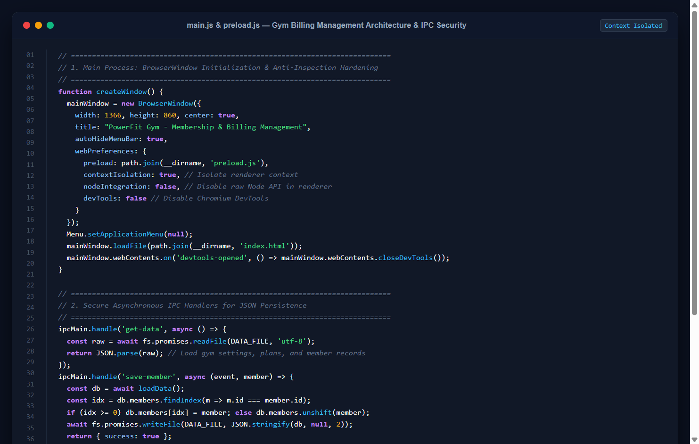

# Gym Membership & Billing Management

**Project Report**  
**Date:** November 21, 2026  
**Application:** Electron desktop application

## i) Problem Statement

Gym operators need to manage member contact details, membership plans, validity periods, payments, and outstanding dues. Separate records make it difficult to identify expired memberships and payment issues. Manual bills involving plan fees, admission or add-on charges, discounts, tax, and payments are also prone to errors. This application brings member management and membership billing into a single desktop workflow.

## ii) Introduction

Gym Membership & Billing Management is an Electron desktop application built with Node.js, HTML, CSS, and JavaScript. It stores gym settings, membership plans, and member records in `data.json`. The application supports monthly, three-month, six-month, and yearly plans. It calculates validity dates, subtotal, flat or percentage discounts, tax, amount paid, and due balance.

## iii) UI/UX Design — Desktop Application Screens

The native desktop application uses a left navigation sidebar and a main workspace. Dashboard cards summarize members, billed revenue, payments received, and outstanding dues. The member list supports search and plan/status filters. The new-member form places member information and plan selection alongside the live bill summary.

The four primary views are:

1. **Dashboard & Billing** — membership/payment totals and recent member invoices.
2. **Member Directory** — member records and membership/payment status.
3. **Add Member & Bill** — member form, plan selection, and live billing calculation.
4. **Rates & Settings** — gym details, membership plans, and fee settings.

The following captures are reserved for the corresponding views in the **native Electron window**, not the browser preview:

### Dashboard & Billing

### Member Directory

### Add Member & Bill

### Rates & Settings

## iv) Main Components of the Project

- `main.js` creates the native window, initializes `data.json`, and provides member/settings IPC handlers.
- `preload.js` exposes the limited `electronAPI` required by the renderer.
- `index.html` and `style.css` define the dashboard, member form, directory, and settings screens.
- `script.js` handles navigation, membership validity, fee calculation, search, and rendering.
- `data.json` stores gym settings, membership plans, and member records.
- `start.bat` is the project launcher.

The billing calculation combines membership, admission, and add-on fees, then applies the configured discount and tax before subtracting the paid amount.

## v) Discussion — ElectronJS

Electron provides a Chromium renderer for the user interface and a Node.js main process for native window and local file operations. In this application, `main.js` owns data persistence and registers IPC handlers. `preload.js` exposes a limited API through `contextBridge`, while the renderer uses that API rather than accessing the filesystem directly. The project enables context isolation and disables renderer Node integration.

## vi) Conclusion

The application combines gym member records, membership validity, configurable plans, and fee/payment calculations. This provides a single view of active members, billed revenue, payments, and dues. No `.exe`, Linux `.deb`/AppImage, or macOS `.dmg` release bundle was found in the project folder; packaging and installation tests remain necessary for cross-platform distribution.

## Appendix: Code Screenshot

